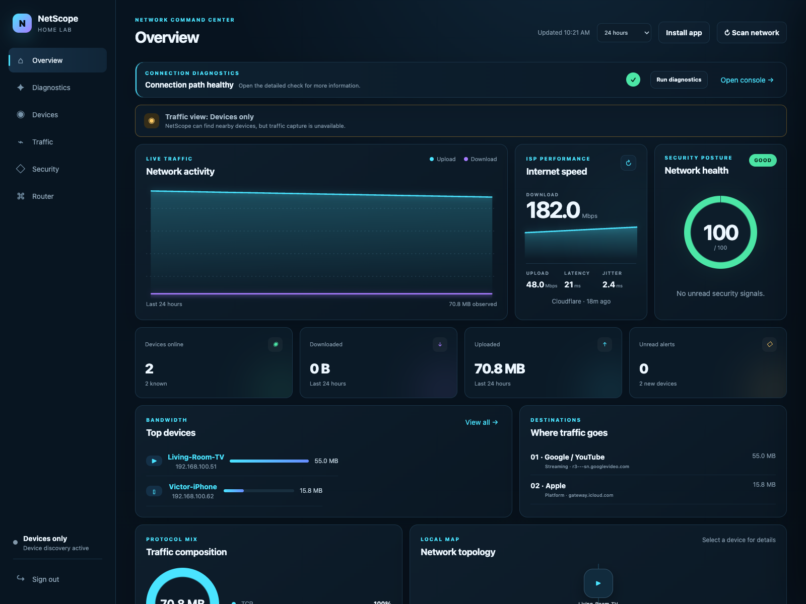
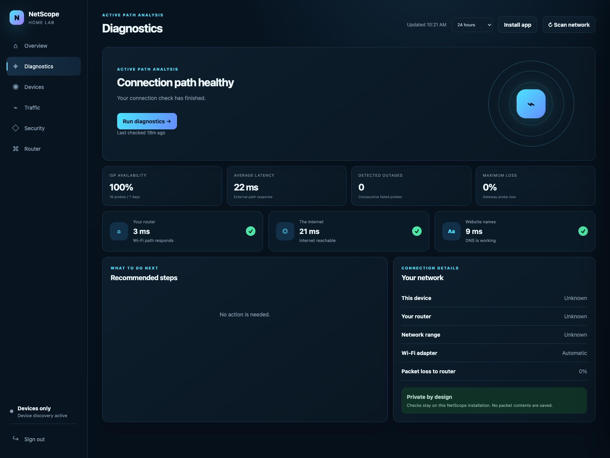

# NetScope

[](https://github.com/Victorgichohi/netscope-home-network-monitor/actions/workflows/tests.yml)
[](https://www.python.org/)
[](https://fastapi.tiangolo.com/)

A private, technical home-network observability dashboard for device discovery, connection diagnosis, traffic metadata, DNS attribution, ISP performance, security signals, and guarded router controls.

## Screenshots





Version 0.4 returns to a technical network-command-center interface while retaining v0.3 diagnostics. It adds bounded download/upload speed tests, latency and jitter measurements, ISP availability analytics, speed history, selectable traffic windows, destination service classification, and automatic device-type inference.

## What it does

- Detects the active IPv4 interface and subnet automatically, or accepts explicit overrides.
- Detects the default gateway and separately checks the router path, internet reachability, DNS, latency, and packet loss.
- Explains whether a problem appears to be local Wi-Fi, the ISP connection, DNS, congestion, or a specific service.
- Stores lightweight diagnostic history and runs checks automatically every five minutes by default.
- Runs manual bounded internet-speed samples and stores download, upload, latency, jitter, and transferred-byte measurements.
- Calculates rolling ISP availability, outage sequences, average latency, and maximum gateway packet loss.
- Discovers devices with ARP, enriches MAC addresses with local OUI data, and tracks first seen, last seen, and online/offline state.
- Captures packet header metadata only: source/destination IP, protocol, ports, timestamps, counters, and byte totals. It never stores payload bytes.
- Observes DNS answers and attributes later destination IPs to recently observed domain names.
- Classifies recognizable destinations such as YouTube, Netflix, Apple, Microsoft, AWS, Cloudflare, and Meta locally without sending captured destinations to an enrichment service.
- Applies configurable retention (30 days for flows and 7 days for DNS observations by default).
- Provides per-device history, traffic timelines, top-destination aggregation, and audit history through authenticated APIs.
- Tracks forwarded inbound and outbound traffic separately when deployed on the router.
- Flags newly discovered devices, online/offline changes, and unusual outbound service ports.
- Lets you categorize devices and mark them trusted, guest, under review, or blocked.
- Supports disabled-by-default router control through strict-host-key SSH or generic authenticated HTTP adapters.
- Protects state-changing endpoints with signed HttpOnly sessions, CSRF tokens, confirmation, rate limits, and audit logging.
- Clearly labels traffic visibility as device discovery only, this computer, or whole network.
- Provides a first-run local setup screen when no administrator is configured.
- Installs as a PWA from a supported browser and includes a `netscope` desktop launcher.

Only monitor networks and devices you own or are authorized to administer.

## Friend-friendly start

The desktop-style launcher creates a private data folder at `~/.netscope`, generates its own local secret, opens the browser, and presents a first-run account screen. No `.env` editing is required for basic diagnostics and device inventory.

```bash
cd home-net-monitor
python3 -m venv .venv
source .venv/bin/activate        # Windows: .venv\Scripts\activate
pip install -e .
netscope
```

The app opens at `http://127.0.0.1:8765`. Close its terminal window to stop it.

## Advanced start

Python 3.11+ and libpcap are required. ARP scanning and packet capture generally need elevated network capabilities.

```bash
cd home-net-monitor
python3 -m venv .venv
source .venv/bin/activate
pip install -e '.[test]'
cp .env.example .env
```

Generate values for `HNM_SECRET_KEY` and `HNM_ADMIN_PASSWORD` in `.env`, then run:

```bash
uvicorn app.main:app --host 127.0.0.1 --port 8000
```

Open `http://127.0.0.1:8000`. API documentation is at `http://127.0.0.1:8000/docs`.

Existing v0.1 SQLite databases are upgraded automatically on the next startup. The migration is additive and preserves the existing device and traffic records.

Connection diagnosis is enabled by default. It performs tiny reachability and DNS probes rather than a bandwidth-heavy speed test. Configure the interval with `HNM_DIAGNOSTICS_INTERVAL_SECONDS`; disable it with `HNM_DIAGNOSTICS_ENABLED=false`.

Internet speed testing is manual by default. Each standard run transfers approximately 10 MB down and 2 MB up using Cloudflare's public speed-test endpoints. Change the bounded sample sizes with `HNM_SPEEDTEST_DOWNLOAD_BYTES` and `HNM_SPEEDTEST_UPLOAD_BYTES`. To opt into a scheduled test, set `HNM_SPEEDTEST_SCHEDULED=true`; the default interval is six hours.

The scheduled discovery job begins after one configured interval. To run it immediately:

```bash
python -c 'from app.config import get_settings; from app.services.discovery import DiscoveryService; print(DiscoveryService(get_settings()).run())'
```

## Passive traffic capture

Set `HNM_TRAFFIC_CAPTURE_ENABLED=true`. On Linux, granting only the Python executable the required capabilities is preferable to running the whole web service as root:

```bash
sudo setcap cap_net_raw,cap_net_admin=eip "$(readlink -f .venv/bin/python)"
```

On macOS/BSD, packet capture permissions depend on the BPF device configuration. Use a dedicated service account and limit dashboard access to localhost, a trusted management VLAN, or a TLS reverse proxy. Capture visibility also depends on topology: a normal switched LAN only exposes traffic addressed to the monitor. Use a router-side collector, mirror/SPAN port, or supported access-point telemetry for whole-network visibility.

If `/dev/bpf*` is owned by `root:wheel` with mode `600`, an ordinary user cannot capture packets. For a short localhost-only test, stop the service and run `sudo .venv/bin/uvicorn app.main:app --host 127.0.0.1 --port 8000`. Do not expose a root-run web process to the LAN. For regular use, install the official Wireshark ChmodBPF helper so a dedicated group can access BPF without running the portal as root.

## Router adapters

Router control remains unavailable while `HNM_ROUTER_ADAPTER=disabled`.

For SSH, set `HNM_ROUTER_ADAPTER=ssh`, host, username, and either password or a restricted private key path. Add the router host key to the service account's `known_hosts`; unknown host keys are rejected. Set vendor-specific status and reboot commands. The SSH account should be allowed to run only those commands.

For HTTP, set `HNM_ROUTER_ADAPTER=http`, the status/reboot URLs, and bearer token if the router API uses one. TLS verification is enabled by default. Because consumer-router APIs vary widely, validate the exact endpoints and response behavior from the vendor documentation before enabling reboot.

## Sharing and app installation

- **Mac and Windows:** `netscope` already behaves like a local desktop app. A distributable `.app` or `.exe` can be built with PyInstaller on its target operating system; builds are OS-specific.
- **Chrome and Edge:** use the browser's Install App action. NetScope includes a manifest, icon, offline shell, and standalone display mode.
- **iPhone and Android:** the dashboard is responsive and PWA-ready. A phone should connect to a NetScope service running on an always-on computer or home server; mobile operating systems do not allow an ordinary app to passively inspect all Wi-Fi traffic.
- **Remote phone access:** expose NetScope only over trusted HTTPS on the home LAN or through a private VPN. Do not publish the service directly to the internet.

For a desktop bundle after installing PyInstaller, build on each target OS:

```bash
pyinstaller --noconfirm --windowed --name NetScope \
  --collect-all app --collect-all scapy --hidden-import manuf app/desktop.py
```

Basic diagnosis works without elevated access. Full ARP discovery and packet capture may still require operating-system permission, even in a packaged application.

## Tests

```bash
pytest --cov=app
```

## API highlights

- `POST /api/auth/login`, `POST /api/auth/logout`, `GET /api/auth/me`
- `GET /api/auth/setup-status`, `POST /api/auth/setup`
- `GET /api/overview`, `GET /api/system/status`, `POST /api/discovery/scan`, `GET /api/devices`, `PATCH /api/devices/{id}`
- `POST /api/diagnostics/run`, `GET /api/diagnostics/latest`, `GET /api/diagnostics/history`
- `GET /api/diagnostics/uptime`
- `POST /api/speedtest/run`, `GET /api/speedtest/latest`, `GET /api/speedtest/history`
- `GET /api/analytics/household`, `GET /api/activity`
- `GET /api/devices/{id}/traffic`
- `GET /api/devices/{id}/detail`, `GET /api/topology`
- `GET /api/traffic/top-destinations`, `GET /api/traffic/top-devices`, `GET /api/traffic/protocols`, `GET /api/traffic/timeline`
- `GET /api/security/summary`, `GET /api/alerts`, `POST /api/alerts/{id}/read`
- `GET /api/router/status`, `POST /api/router/reboot`
- `GET /api/audit`

## Production notes

Keep `.env` out of source control, serve through HTTPS, set `HNM_SESSION_HTTPS_ONLY=true`, bind only to a trusted interface, and back up the SQLite database. For high traffic volume, move flow storage to PostgreSQL and batch collector writes. The generic HTTP adapter intentionally does not guess vendor behavior; a dedicated adapter can implement a router's documented authentication and reboot semantics behind the same `RouterController` interface.
